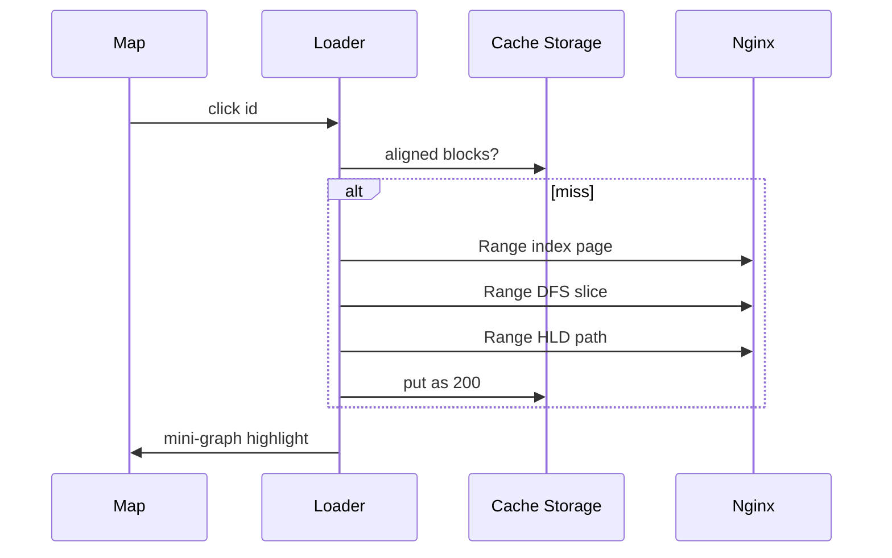

# Range-loaded river graph

| | |
| --- | --- |
| Status | Draft |
| Created | 2026-11-25 |
| Path | `docs/specs/2026-11-25-graph-range-loading-design.md` |

## Objective

Let the map paint before any graph download, then fetch only the tributary tree of a tap and its path to the mouth.

## Background

`mountMap` waits for the whole `reaches.bin` before it constructs MapLibre. Australia is 34 MB on disk (about 21 MB gzip, 2.6 million reaches). New Zealand is 8.3 MB. After that wait the map still loads PMTiles by range request. Search uses a separate `names.json` (3 MB Australia) on first keystroke.

A tap walks a directed forest (each reach has one `down`). Today it then walks **upstream from the mouth**, so one click holds the whole basin. The packed HWG1 table matches “load the nation, then every tap is local.” That was acceptable when the nation was New Zealand. Australia is not.

Literal precomputed ID lists for every reach’s upstream tree and downstream path are 4.3 GB for Australia and 716 MB for New Zealand. The same facts compress to intervals and heavy paths in a still-national file.

## Goals

- First map paint does not wait for the graph.
- A tap does not download or hold the national graph. It holds the selected-point slice only.
- Search does not download a 3 MB JSON index before the first letter.
- A data Release can replace the graph without serving stale Cache Storage slices.

## Non-goals

- Changing what a tap *means* beyond selected-point (downstream to the mouth, plus tributaries of the clicked reach). Catchment polygons, 3D, and PostGIS stay out.
- Topology PMTiles, per-basin files, or a service worker.
- Stamping graph indexes onto draw tiles (no tile rebuild).
- Capping or paging a Murray-mouth tap (~287k reaches). That hitch is accepted.
- Making Vite/dev-server range support a format constraint; fix the server if it does not honour `Range`.

## Constraints

- Static nginx. No app server, no PostGIS.
- Graph walks must not invent edges. Lake chords stay in the graph and stay out of draw tiles.
- Range requests need raw offsets, so nginx must not gzip the new `.bin` files (same as `.pmtiles`).
- The Cache API rejects HTTP 206. Workbox range plugins need a full 200 of the whole file, which we will not download.
- REC2 remains CC BY-NC 4.0. This work does not change licences.

## Scenarios

1. **Open the map.** MapLibre starts. PMTiles paint. The loader idle-fetches the graph header, interned strings, and id-index root (~360 KB Australia).
2. **Click a headwater.** One index page (if cold), the DFS slice, a 24-byte HLD peek for `path_hi`, then `[hld_index, path_hi)`. Highlight that creek’s catchment and the route to the sea. Sibling rivers in the same basin stay unpainted.
3. **Click the Murray mouth.** The DFS slice is that basin (~287k records, a few MB). The map may hitch. The rest of Australia stays on disk.
4. **Shared `#id`.** Same id index as a click. Unknown id clears the selection.
5. **Type `m`.** Range-request the `m` span of `names.bin`. Filter in memory. The start list on the empty panel does not wait for this.
6. **New data Release.** Header `build_id` does not match Cache Storage meta. Delete that cache. Next tap refills blocks.

## Interfaces

### `reaches.bin` — magic `HWG2`

Little-endian. One file per country. Fixed-size records so a span is `section_offset + index * 24`.

**Header** (enough to range-request every later section): magic, version, `count`, `build_id` (changes every export), offsets and lengths for the string table, id-index root, id-index pages, DFS records, HLD records. Offsets are `u32`.

**String table.** Interned UTF-8 names. `name_idx` `0xFFFF` means unnamed. Unique names fit in `u16`.

**Id index.** Ids sorted. Root is one record per page (`first_id`, page offset). Each page is 1024 entries of `{id, dfs_index, hld_index, subtree_size}`. Click, hash, and search all resolve through this index. Draw tiles keep today’s feature `id` only.

**DFS records** (24 bytes): `id`, `length_m`, `name_idx`, `flags` (bit 0 = inland sink), `subtree_size`, padding. Packed depth-first from each sink. The tributary tree of packed index `i` is `[i, i + subtree_size)`. Children of `i` are recovered from those sizes; the browser does not build a national `up` index.

**HLD records** (24 bytes): `id`, `length_m`, `name_idx`, `flags`, `path_hi` (exclusive end of this heavy path toward the mouth), `parent_hld` (packed HLD index of the immediate downstream reach, `0xFFFFFFFF` = sink). Index `0` is a valid row, so the sink sentinel must not be `0`. Heavy child = largest `subtree_size`. A tap peeks the record at `hld_index` for `path_hi`, reads `[hld_index, path_hi)`, and follows `parent_hld` of the last row if that is not the sink.

Australia on disk is about 124 MB because records are stored twice. The browser never fetches the whole file.

Production reads `HWG2` only. No v3 fallback.

### `names.bin` — magic `HWN1`

Little-endian. Not gzipped (range requests). Header includes the same `build_id` as that country’s `reaches.bin`.

- Start block: the country’s start-list hits (`name`, `id`, `metres`, bbox), in the same order as `countries.ts`. Missing names are omitted.
- Prefix directory: offset + length per folded first letter (`a`–`z` plus one catch-all). Folding matches today’s search (NFD, strip marks, lower case).
- Records packed by prefix, same fields as today’s `RiverHit`.

Drop `names.json` from the `data` Release when these files ship.

### HTTP and cache

- nginx: `gzip off` and `Accept-Ranges: bytes` for `.bin`, as for `.pmtiles`.
- Graph loader uses `Range`. After a 206, store the **bytes as a 200** in Cache Storage under a key that includes the aligned byte range (loader-chosen page size, e.g. 16 KiB). Never `cache.put` a 206.
- Cache name is stable. On boot, fetch the graph header with `cache: 'reload'`. If `build_id` disagrees with stored meta, delete the cache. Name prefix spans use the same Cache Storage rules.
- Quota failure on `put` is ignored; the tap already has the bytes in memory.
- One mini-graph in JS heap: the current selection only.

### Tap highlight

Replace “whole basin from the mouth” with selected-point:

- Tributaries = DFS slice minus the click.
- Downstream = HLD chain minus the click.
- Furthest source / longest path = inside the DFS slice, then along the HLD chain to the mouth.
- Panel names, lengths, inland heading, and gap note stay as they are, on this mini-graph.

A newer tap cancels in-flight fetches. Until slices return, keep the existing tracing-network loading state. Visitor strings added or changed in implementation go through the humanize skill.

## Diagrams

## Alternatives considered

**Full upstream/downstream ID lists on every reach.** Same precalculation. 4.3 GB Australia. Rejected.

**DFS intervals only, follow `down` hop by hop.** Downstream is a linked list (mean ~200 hops Australia). Serial range requests. Rejected in favour of a second (heavy-path) copy of the records.

**One HWG1 file per basin.** Simple keys from a `basin_id`. A headwater tap of the Murray still downloads ~287k reaches. Tens of thousands of sinks. Rejected.

**Topology PMTiles.** Spatial index for a tree query. Archive cannot be gzipped. Needs an id→tile map. Larger on disk than a packed table for the same rows. Rejected.

**Service worker cache rule / Workbox `RangeRequestsPlugin`.** Cache API rejects 206. Those plugins slice a **full** cached 200. That is a 124 MB download. Rejected. Page Cache Storage with aligned 200 bodies is the persistence layer.

**Show the map first, still download the whole graph in the background.** Fixes first paint only. Still 21 MB and 2.6 million JS rows. Rejected as the product goal.

## Open issues

**Vite/Astro `Range` in `npm run dev`.** Unknown whether `web/public/data/*.bin` honours byte ranges. Next step: one request against the dev server in the first implementation slice; add middleware only if it fails.
